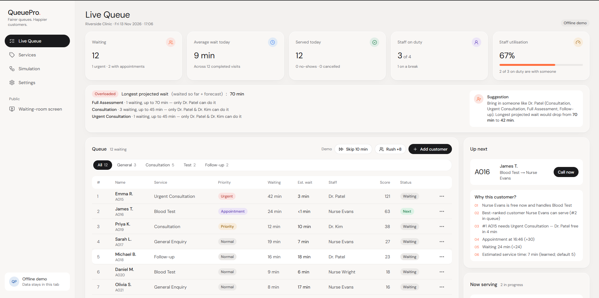
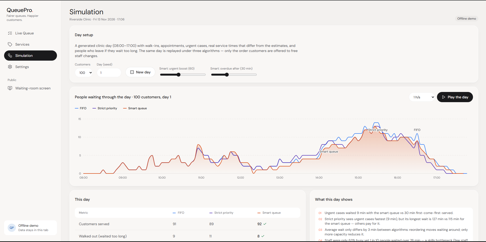
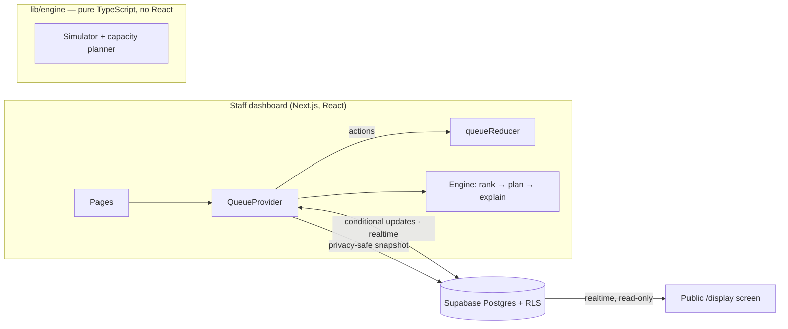
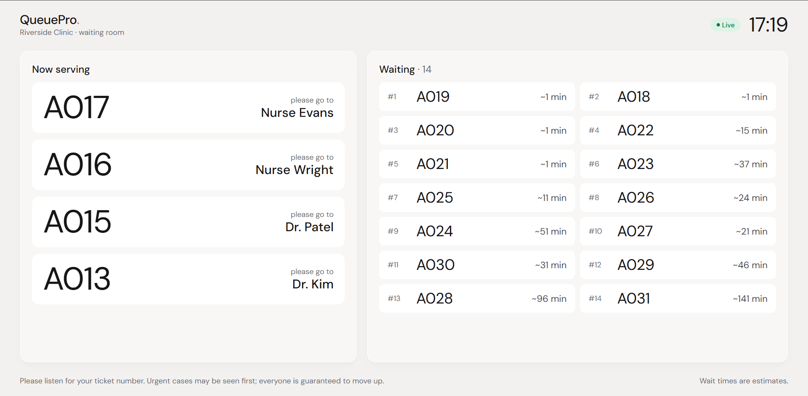

# QueuePro — a fair, explainable queue for busy clinics

[](https://github.com/snare0625/smart-queue-management/actions/workflows/ci.yml)

**[Live demo →](https://smart-queue-management-pi.vercel.app/)** — click **"Explore the demo — no account needed"** · [Public waiting-room screen →](https://smart-queue-management-pi.vercel.app/display)

First come, first served is easy. QueuePro decides who should be served next when one customer needs 5 minutes and another 45,
an appointment arrives early, an urgent case walks in, and somebody has already waited an hour — and it **explains every decision**.



---

## What it does

- **Ranks the queue with a transparent scoring algorithm** — waiting time, urgency, appointments and service length, with a proven fairness guarantee.
- **Assigns the best qualified staff member** and forecasts every customer's wait by replaying the queue forward in time.
- **Explains "why this customer?"** in plain language, generated from the same numbers that made the decision.
- **Learns real service times** from completed visits, so estimates improve during the day.
- **Public waiting-room screen** that shows ticket numbers only — no names, services or urgency ever leave the staff side.
- **Detects overload** per service and **recommends extra staff**, tested by re-running the forecast.
- **Simulates a full clinic day** (50–120 customers) and compares three algorithms, with playback and 20-day averages.
- **Multi-desk, real-time**: staff sign in; every desk and screen stays in sync through Supabase.

## How the smart queue decides

Every waiting customer gets a score; the highest score is served next by the first qualified, free staff member.

| Part | Points | Why |
|---|---|---|
| Waiting time | 1 per minute | The backbone — on its own this is first come, first served |
| Overdue | +1 per minute past 30 min | Long waits climb twice as fast |
| Urgent / priority | +60 / +20 | Lets urgent cases jump ahead … |
| Appointment | +30 from 10 min before the slot | Honours bookings; arriving very early earns nothing |
| Quick service | up to +10 | Nudges short jobs forward without letting them jump big gaps |

**Fairness guarantee:** a brand-new arrival can score at most 70 (urgent + quickest service), while a waiting customer's score grows
without limit. After about 50 minutes, **nobody can overtake them** — urgent cases jump the queue, but can't push anyone back for ever.
A unit test proves it.

Ranking (*who deserves to go first*) is kept separate from planning (*who can actually be seen, by whom, when*): if the top customer needs
a doctor and only a nurse is free, the nurse takes the best-ranked customer they're qualified for — and the explanation says so.

## What the simulation found

Same generated days, three algorithms, averaged over 20 busy days (100 customers each):

| | First come, first served | Strict priority | **Smart queue** |
|---|---|---|---|
| Urgent cases' average wait | 38 min | **8 min** | 16 min |
| Longest wait | 117 min | 122 min | **113 min** |
| Appointments seen on time | 28% | 30% | **36%** |
| Walked out | 6.9 | 7.2 | **6.2** |
| Average wait | 26 min | 24 min | 25 min |

- **Strict priority** sees urgent cases fastest but starves everyone else. **FIFO** ignores urgency. The smart queue balances both.
- **The average wait barely moves, whatever the algorithm.** Reordering only redistributes waiting; only capacity reduces it.
  Staff were ~63% busy yet waits were long because few staff can do consultations — so the app also **recommends when to add staff**
  (e.g. one extra doctor 13:00–17:00 cut the slowest 10% of waits from 76 to 45 min and walk-outs from 8 to 0).



## Architecture



- **The engine is pure TypeScript** (`lib/engine`): scoring, planning, the visit lifecycle reducer, learning, simulation and capacity planning.
  The live app, the simulator and the tests all run the same code.
- **Every change is an action through one reducer** — applied instantly on screen, then written to the database in the background.
- **Two desks can't call the same customer**: each write is a conditional update (`… WHERE status = 'waiting'`); if another desk got there
  first, nothing changes, the app says so and reloads.
- **Privacy is enforced in the data, not the UI**: the waiting-room screen receives a snapshot built on the staff side with ticket numbers
  only, and Row Level Security means the public key can read nothing else.



## Engineering notes

- **69 automated tests** (Vitest): scoring scenarios, the fairness bound, staff assignment, lifecycle, learning, privacy snapshot,
  database row mapping, simulation invariants and capacity planning.
- **CI on every push** (GitHub Actions): typecheck, tests, production build, plus a **security check that attacks the real database with
  the public key** and fails if any private data is readable or writable.
- **Database rules enforced by Postgres**: CHECK constraints, a partial unique index (a staff member can serve one visit at a time) and RLS.
- **Measured decisions**: chart colours validated for colour-vision deficiency (the design system's blue/purple failed — see
  [CHART-PALETTE.md](docs/design-system/CHART-PALETTE.md)); the animation library's cost measured per route (+44 kB on the staff dashboard,
  0 kB on the public screen); the font bundled after a CI run failed on a network fetch.
- **Accessible by default**: status is always a word, not just a colour; keyboard focus everywhere; `prefers-reduced-motion` respected;
  toasts announced to screen readers.

## How this was built

Built with **Claude Code as an AI pair programmer**, one feature at a time. Each feature came with automated tests, and CI runs them
on every push. Design choices were checked with data rather than assumed: the simulation compares algorithms over 20 days, the chart
palette was run through a colour-vision validator, and bundle sizes were measured per route. Some first attempts were changed because of
what those checks showed, such as the lazy-loading experiment and the label placement. A manual acceptance checklist covering every
feature is in [docs/TESTING.md](docs/TESTING.md).

## Tech stack

Next.js 15 · React 19 · TypeScript · Supabase (Postgres, Auth, Realtime, RLS) · Vitest · GitHub Actions · Vercel · Motion · Paper Calm design system

## Run it locally

```bash
npm install
npm run dev        # http://localhost:3000 — runs as an offline demo with no setup
npm test           # 69 tests
```

To use Supabase: create a project, run [`supabase/migrations/0001_init.sql`](supabase/migrations/0001_init.sql) in its SQL editor,
create a staff user (Authentication → Users), and add to `.env.local`:

```dotenv
NEXT_PUBLIC_SUPABASE_URL=https://<project>.supabase.co
NEXT_PUBLIC_SUPABASE_ANON_KEY=<publishable / anon key>
```

`npm run check:rls` then verifies that the public key can't read or change private data.

## Project structure

```text
lib/engine/      scoring, assignment & forecasting, lifecycle reducer, learning, public view, simulation, capacity planning
lib/db/          Supabase client, row ↔ engine mapping, repository (all database reads/writes)
lib/sync/        dashboard → waiting-room screen (Supabase Realtime, or BroadcastChannel offline)
components/      dashboard pages, simulation, waiting-room display, design-system primitives
supabase/        SQL schema, constraints and Row Level Security policies
docs/            design system (Paper Calm), chart palette validation, screenshots
```
